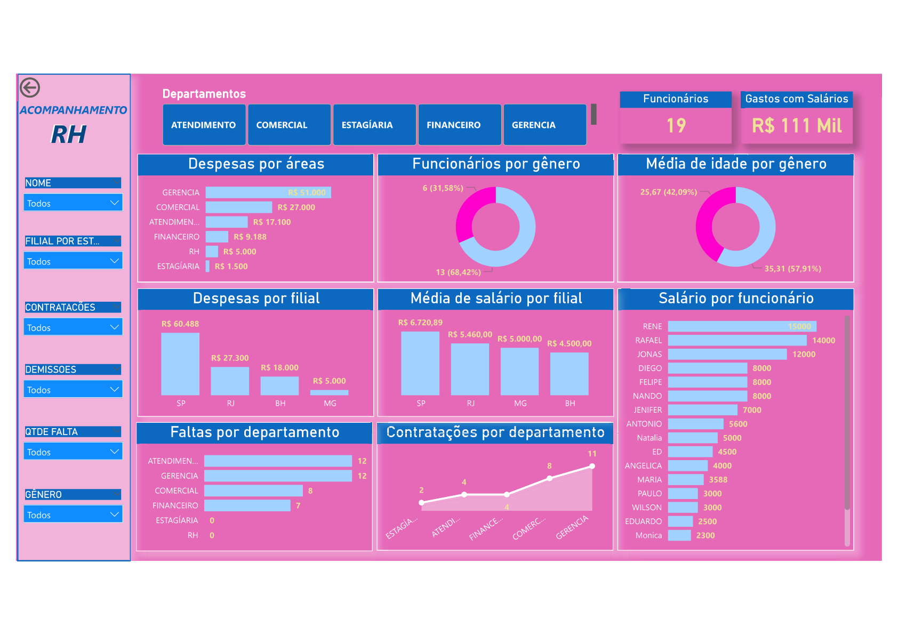

# Dashboard de Recursos Humanos | Power BI
Estou iniciando minha trajetória na criação de Dashboard com o Power Bi  e este é o meu 3o. projeto com a ferramenta.

Projeto de visualização e acompanhamento de indicadores de Recursos Humanos, desenvolvido no **Microsoft Power BI**.

## Objetivo

Consolidar indicadores de quadro de funcionários, salários, despesas, contratações e faltas para facilitar a análise de RH por departamento e filial.

## Indicadores e recursos

- **19 funcionários** e gastos com salários de aproximadamente **R$ 111 mil**, conforme os cartões do painel.
- Distribuição de funcionários e média de idade por gênero.
- Despesas por área e por filial.
- Média salarial por filial e salário por funcionário.
- Faltas e contratações por departamento.
- Filtros de nome, filial, contratações, demissões, quantidade de faltas e gênero.

## Insights observados

1. **Despesas por área:** Gerência lidera com **R$ 51.000**, seguida do Comercial (**R$ 27.000**) e Atendimento (**R$ 17.100**).
2. **Distribuição de funcionários por gênero:** os grupos exibidos correspondem a **13 (68,42%)** e **6 (31,58%)** pessoas. A imagem não permite confirmar a legenda de cores de cada gênero.
3. **Média salarial por filial:** São Paulo tem a maior média (**R$ 6.720,89**); Belo Horizonte tem a menor (**R$ 4.500,00**). Essa comparação não ajusta por cargo ou composição das equipes.
4. **Faltas por departamento:** Atendimento e Gerência registram **12 faltas cada**, seguidos pelo Comercial (**8**) e Financeiro (**7**). Os números são absolutos e não representam taxas de absenteísmo.
5. **Contratações por departamento:** Gerência aparece com **11**, Comercial com **8**, Atendimento e Financeiro com **4 cada** e Estagiária com **2**. O período não está informado no painel.
6. **Despesas por filial:** São Paulo apresenta o maior valor (**R$ 60.488**), seguido de Rio de Janeiro (**R$ 27.300**), Belo Horizonte (**R$ 18.000**) e Minas Gerais/MG (**R$ 5.000**), conforme rótulos exibidos. Vale padronizar as categorias geográficas, pois BH é cidade e MG é estado.

Veja também: [Análise detalhada dos indicadores](INSIGHTS.md).

## Tecnologias

- Microsoft Power BI
- Visualizações interativas e segmentações de dados

## Arquivos

- `README.md`: documentação e principais insights.
- `INSIGHTS.md`: interpretação dos indicadores e melhorias sugeridas.
- `rh_dashboard.png`: imagem do painel.
- `Projeto RH.pdf`: exportação do dashboard.

> **Dados:** a autora confirmou que os nomes e a base usados neste projeto são fictícios.
